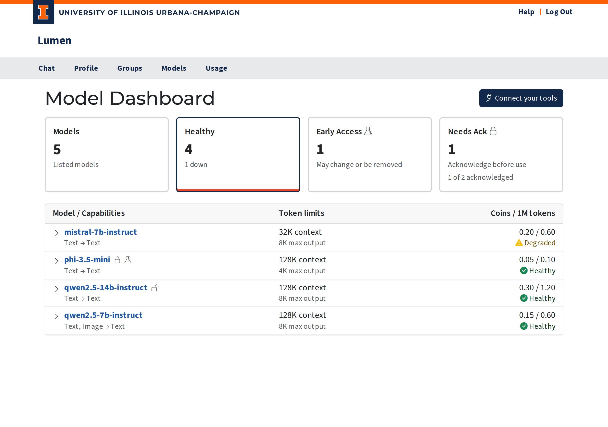

# Models

The **Model Dashboard** (`/models`) shows every AI model available to you in your Lumen instance, with a summary of their health at the top and one compact row per model below. Models that are owned by another user are not listed, and their detail URLs return **Not Found** without exposing metadata. Disabled, expired, and deleted models are hidden the same way.

The **Connect your tools** button in the header takes you to the setup instructions for your coding tools and SDKs.

If a model you need is not listed, you can launch it yourself with [LLMHub](https://llmhub.computes.illinois.edu). If your administrator has configured an LLMHub link, it appears below the model list.

## Summary Cards

Four cards at the top summarise the models listed for you:

| Card | Number | Subtitle |
|------|--------|----------|
| **Models** | Every model listed on the page, including models with no endpoints | "Listed models" |
| **Healthy** | Models that can serve requests right now: **Healthy** and **Degraded** models (at least one working backend) | The number of **Down** and **No endpoints** models when there are any (e.g. "1 down · 2 no endpoints"); otherwise the number of **Degraded** models; otherwise "All healthy" |
| **Early Access** | Early-access models, which may change or be removed at any time | "May change or be removed" |
| **Needs Ack** | Models you still have to acknowledge before you can use them | "Acknowledge before use" with how many of the models that need acknowledging you have already accepted (e.g. "1 of 3 acknowledged"); "All 3 acknowledged" once you have accepted them all; "Nothing to acknowledge" when no model needs it |

The flask after **Early Access** and the lock after **Needs Ack** are the same icons the model rows show next to a name.

The cards are worked out when the page loads; reload the page to update them, for example after acknowledging a model.

## Filtering

Click a card (or tab to it and press Enter or Space) to show only the models it counts. The active card has a dark blue border with an orange bar along the bottom; click **Models** to show every model again.

| Card | Shows |
|------|-------|
| **Models** | Every model |
| **Healthy** | **Healthy** and **Degraded** models |
| **Early Access** | Early-access models |
| **Needs Ack** | Models you still have to acknowledge; models you have already accepted are left out |

The numbers on the cards always count every model, whichever card is active. If no model matches, the list reads "No models in this view."

The page address remembers the active card (for example `/models?show=healthy`), so reloading the page or sharing the link opens the same view. The values are `healthy`, `early_access` and `needs_ack`; without one, or with any other value, every model is shown.

## Model Rows

Each model is one row with three columns. Without opening it, a row shows:

- **Model / Capabilities**
  - **Name** — links to the [model detail page](model-detail.md). A closed lock next to the name means you still have to acknowledge the model's terms before you can use it, and an open lock means you already have; a flask icon marks an early-access model.
  - **Modalities** — what the model accepts and produces, as input → output (e.g. `Text, Image → Text`). A dash means the instance hasn't published that information.
- **Token limits** — the model's context window (e.g. `128K context`) and, below it, the most tokens it can generate per response (e.g. `8K max output`). A dash means the value is not set.
- **Coins / 1M tokens** — the price per million input / output tokens (e.g. `1.00 / 2.00`), with the model's health (see below) under it.

On a phone the token limits move under the model name, next to the price.

### Health Labels

| Label | Meaning |
|-------|---------|
| **Healthy** (green check) | All backends are healthy — model is fully available |
| **Degraded** (yellow warning) | Some backends are down, but at least one is working |
| **Down** (red cross) | No backends are reachable — model is temporarily unavailable |
| **No endpoints** (grey) | No backends have been set up for this model |

The **Healthy** card counts **Degraded** models too, because they still answer requests; the row keeps the separate **Degraded** label so you can see the model is running with fewer backends.

## Model Details

Click anywhere on a row (or tab to the arrow at its start and press Enter or Space) to open the model's details; clicking the model name still opens its detail page. Only one row is open at a time: opening another row closes the previous one. The details show:

- **Health** — **Last checked**: how long ago the most recent health check ran (e.g. `5 min. ago`); hover over or tab to it for the full date and time. It updates every minute while the page is open. **Never** means no check has run yet. **Health checks**: how many of the model's backends passed their last check out of the total configured (e.g. `2/4 passed`).
- **Detailed pricing** — coins per million tokens for **Input**, **Output**, **Cached read** and **Cached write**. A cache-read rate the model does not configure is billed at the input price and a cache-write rate at 0, so these always show what you are actually charged.
- **Access** — see below.

## Access

Models that require a one-time acknowledgment show an **acknowledge** button under **Access**, and early-access models show an **early access** button — these models may change or be removed at any time, and you must acknowledge that before using them. Click either button to open the acknowledgment dialog, which shows every notice that applies to the model. **Accept & Enable** records your acknowledgment and the buttons are replaced by a green **granted** pill; click **granted** to see the notices you accepted and when you acknowledged them. **Cancel** leaves the model unchanged. If a model gains a new requirement after you acknowledged it, its buttons appear again until you acknowledge the new terms. Models without requirements show **Open**. A model with an end date disappears from this page once the date passes.

## Understanding Pricing

Coins are Lumen's internal currency. See the [Introduction](../introduction.md#tokens-and-coins) for a full explanation of how tokens and coins relate. The prices shown here are per million tokens — typical single messages cost a small fraction of that.

Prompt-cache reads and writes are priced separately when a model configures those rates. With no cache-read rate, cached tokens are charged the normal input price; with no cache-write rate, cache writes are free. The **Detailed pricing** section shows those figures.

Models with higher output rates tend to be more capable or larger. If you are cost-sensitive, compare models on the detail page before running a long batch job.
